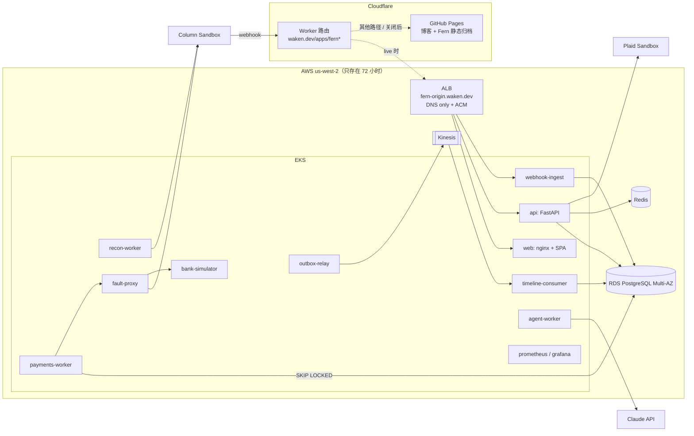

# Fern — AI-first 数字银行后端演示系统 · 设计文档

> 状态：草案 v0.5 · 2026-11-11
> v0.4 的变化：①线上只运行 3 天；②演示只覆盖 5 个常见用户场景；③处理 Codex 第二轮评审（附录 B）。
> v0.5 的变化：主银行从 Increase 换成 **Column**（持牌银行 Column N.A.）。§6.4 列出 Column 的能力核对结果和带来的设计调整。
> 项目名 `Fern`，部署在 `waken.dev/apps/fern`。**不使用 Green 的名称或品牌。**
> 本文是内部工作稿，用中文写。对外展示版（README、/eng 页面）用英文。

---

## 0. 目标与约束

**目标：** 用 5 个常见的数字银行用户场景，完整展示一套生产级后端。每个场景都能同时从四个视角查看：用户端、运营后台、账本 / 对账、工程监控。其中两个场景可以在线触发故障，展示系统怎么恢复。

**约束：**

| 约束 | 含义 |
|---|---|
| 只覆盖 5 个场景（§1） | 所有模块、页面、测试都服务于这 5 个场景；不在场景内的功能不做 |
| AWS 总寿命 72 小时 | 72 小时包括预热和销毁时间；对外可交互的时间少于 72 小时 |
| 关闭后作品继续存在 | `waken.dev/apps/fern/` 在关闭后变成静态归档（§12.4），永远不会返回 502 |
| 资金正确性不打折 | 运行时间短不能成为简化正确性的理由：三天里出一次错，就可能毁掉整个展示窗口 |

**成功标准：** 一个懂支付的工程师花 10 分钟浏览（在线时浏览实时系统，关闭后浏览归档），能得出三个结论：

1. 这个人知道钱在系统里怎么流动，出错时每一分钱在哪里。
2. 这个人能独立把复杂系统从设计做到上线、值守、关闭和归档。
3. 这个人知道 AI 在金融运营里应该放在什么位置。

---

## 1. 五个用户场景

| # | 场景 | 用户端 | 运营 / 账本视角 | 可在线触发的故障 |
|---|---|---|---|---|
| **S1** | 开户并收到第一笔工资 | 虚构身份开户 → KYC 通过 → 收到一笔 $2,000 的模拟工资 | 入向 ACH credit 的银行事实 → `ach_in.credit` 分录 → 对账匹配 | — |
| **S2** | 绑定外部银行账户并入金 | Plaid 绑定（Auth 取得账户号和路由号）→ 授权扣款 → 拉入 $500 → 显示「处理中 / 可用时间」 | Column counterparty、发起的 ACH debit、restriction 的生命周期、银行日历（演示时钟） | — |
| **S3** | 给朋友转账 | 转 $50 给空间内的 NPC「Alex」，即时到账 | 一条 `p2p.transfer` 分录；锁协议；两边余额 | — |
| **S4** | 提现到外部银行 | 提现 $300 → 状态时间线：处理中 → 已提交 → 已到账 | hold → accept → settle 三步分录；unknown 状态的监控 | **银行吞掉响应**（§8.1） |
| **S5** | 入金被退回，账户变成负余额 | S2 的资金变为可用并花掉一部分后，收到「未授权」退回 → 余额为负、提现冻结 | 退回分录、restriction 终止、催收任务、核销审批（maker-checker）、AI 调查报告 | **拉款被拒付**（§8.2） |

**S5 与 Column sandbox 的差距（§6.4）：** Column sandbox 通过收款人姓名的魔法值触发退回，目前只支持 R01、R02、R08、R29，**没有消费者未授权退回 R10**；退回发生的时间点也不由我们控制。**2026-11-12 实测结果：`RETURN_UNAUTH` 的退回恰好在结算那一刻到达**（`settled_at` 与 `returned_at` 相同），此时 restriction 仍然有效。所以 S5 分两段展示：

- 第一段在 Column sandbox 上运行：拉款被退回（R29），restriction 让这次退回**不造成任何损失**，这正是 restriction 存在的意义。页面标注「sandbox 只能模拟 R29；真实消费者账户对应 R10」
- 第二段「如果当初提前放款会怎样」在模拟银行中运行 R10，页面明确标注为模拟银行，展示负余额、冻结和核销

场景之间是连贯的：一个访客按 S1 → S5 的顺序走完，大约需要 5 分钟。

**演示时钟：** 真实 ACH 需要 1–2 个工作日结算，资金可用期还要更久。演示中使用 sandbox 的模拟接口主动推进结算，资金可用期压缩为 10 分钟。所有涉及时间的页面都同时显示「演示时钟」和「真实世界中预计需要的时间」，并明确标注，**绝不把模拟结算说成真实 ACH 几秒钟就能到账**。

### 1.1 不做

- 发卡、投资、加密货币、多币种、跨空间转账
- 提前可用（在结算之前垫资给用户使用），因此不需要平台垫资额度
- 完整 KYC（只做通过 / 拒绝两条路径的状态机）
- 第二家银行适配器、Go 服务拆分、Tempo / Loki、自动日报、完整运营后台

这些放进 §14 的「未来工作」，并在 README 里说明怎么扩展。

---

## 2. 访客视角

```
waken.dev/apps/fern/
├── /       落地页：5 个场景的入口、运行状态（live / draining / archived）
├── /app    用户端：S1–S5
├── /ops    运营后台：本空间的客户 360、转账调查、对账差异、核销审批、AI 调查
├── /eng    工程展示：架构、API、账本浏览器、银行接入状态、监控、演练回放、测试报告
└── /api    REST API
```

### 2.1 演示空间

每位访客点击「开始」后，从**预先创建的账户池**中分配一个演示空间：

- 独立账套（ledger book），独立的科目和余额
- 一个主角客户和一个 NPC「Alex」
- **一个独立的 Column sandbox 银行账户**（同一个平台实体下的多个 bank account，各有自己的 account number）。上线前预先开好 5 个，并通过模拟入向 ACH credit 注资（Column 账户初始余额为 0）。**不做共享银行账户的降级方案**：共享账户无法隔离余额、funds hold 和账户级限额，会破坏「每个空间独立对账」这个前提
- 账户池用完后，新访客在落地页选择一个已有访客的空间进入（`GET /spaces` 列出，`POST /spaces/{id}/join` 进入），和别人共用这个空间。演示数据都是虚构的，共用没有风险

`demo_space_id` 由服务端从会话中确定，贯穿数据库（RLS，§4.4）、任务、事件、银行账户映射、演练和 AI 工具。

**作者的系统空间**是一个常驻空间，已经完整跑过 S1–S5，供 `/eng`、AI 报告和归档使用。

### 2.2 空间期限

空间在整个在线窗口内都可以交互，直到全站进入 draining 状态（§12.3）。「暂停」只会禁止新的资金操作，已经被银行受理的事实会继续处理。

---

## 3. 架构

### 3.1 总览



**资金主路径不经过 Kinesis。** 银行提交、入账和状态转换都由 Postgres 驱动。Kinesis 在 v1 只承载一个消费者：交易时间线投影。它可以随时从 Postgres 的 outbox 表重建；Kinesis 中断时，钱照常正确流动，只有时间线展示会延迟。

### 3.2 技术选型（对齐 Green 的 JD）

| 层 | 选型 |
|---|---|
| 后端 | Python 3.13、FastAPI 模块化单体；一个镜像、多个 Deployment；import-linter 强制模块依赖方向 |
| 数据 | PostgreSQL 16（RDS Multi-AZ，从第一天开始就开启，演示期间不做配置变更）；SQLAlchemy 2 + Alembic；记账走数据库函数 |
| Redis | 限流、缓存、AI 预算的原子预占。不存资金状态 |
| 事件 | Kinesis：outbox → 时间线投影 |
| 部署 | EKS（3 个按需节点，不用 spot，演示期间不缩容）、Helm、Argo CD、Terraform（AWS + Cloudflare） |
| 前端 | React + TypeScript + Vite，打包进 nginx 镜像 |
| 可观测性 | OpenTelemetry → Prometheus + Grafana（固定看板） |
| AI | Claude API tool use |
| CI | GitHub Actions：gitleaks、单元测试、参考模型测试、崩溃注入、契约测试；ARM 镜像预构建 |

### 3.3 模块

```
fern/
├── spaces/      账户池、演示空间、RLS 上下文
├── identity/    虚构身份、KYC 状态机
├── ledger/      科目、记账函数封装、余额查询
├── payments/    转账、hold / restriction、锁协议、apply_bank_fact
├── banking/     Column 适配器、simulator 适配器、错误分类、webhook inbox
├── recon/       对账运行、差异
├── ops/         核销审批（maker-checker）、审计
├── agent/       AI 工具、预算、报告
├── events/      outbox relay、时间线消费者
└── platform/    配置、可观测性、API 幂等、限流、站点状态（live / draining / archived）
```

---

## 4. 账本

### 4.1 符号约定

`postings.amount_minor` 是有符号整数，单位美分，**借为正、贷为负**。每个科目有 `normal_side`。**规范化余额** = 借方科目取 `Σamount`，贷方科目取 `−Σamount`。所有面向业务的余额都使用规范化余额。

### 4.2 科目表（每个账套一份）

| 科目 | 正常方向 | 含义 | 涉及场景 |
|---|---|---|---|
| `asset:bank` | 借 | 本空间独立银行账户中已入账的现金；**只在银行交易入账时变动**，每条 posting 都关联一笔银行交易 | 全部 |
| `asset:ach_debit_receivable` | 借 | 我方发起的拉款已受理、现金未到账 | S2、S5 |
| `liability:customer:{id}:deposit` | 贷 | 客户存款；允许因退回变成借方余额，报表中列为客户应收 | 全部 |
| `liability:ach_credit_pending` | 贷 | 我方发起的出金已受理、现金未划出 | S4 |
| `expense:ach_return_losses` | 借 | 确认无法收回的退回损失 | S5 |
| `suspense:recon` | 两方向 | 对账差异暂挂，日终要求清零或附说明 | — |

### 4.3 效果模板（每种会计效果的唯一合法形态）

`ledger.effect_templates` 定义每种 `effect` 允许的科目角色、借贷方向，以及必须引用的依据。`post_journal` 会逐条校验：

| effect | 借 | 贷 | 必需的依据 |
|---|---|---|---|
| `ach_in.credit` | bank | customer deposit | 银行交易 ID |
| `ach_debit.accept` | ach_debit_receivable | customer deposit | 银行转账 ID |
| `ach_debit.settle` | bank | ach_debit_receivable | 银行交易 ID |
| `ach_debit.return` | customer deposit | bank | 银行退回交易 ID |
| `ach_debit.accept_reversal` | customer deposit | ach_debit_receivable | 「未形成现金交易」的银行事实 |
| `ach_debit.write_off` | ach_return_losses | customer deposit | 已批准的核销单 ID |
| `p2p.transfer` | payer deposit | payee deposit | 转账 ID |
| `ach_credit.accept` | customer deposit | ach_credit_pending | 银行转账 ID |
| `ach_credit.settle` | ach_credit_pending | bank | 银行交易 ID |
| `ach_credit.accept_reversal` | ach_credit_pending | customer deposit | 「未形成现金交易」的银行事实 |
| `ach_credit.return` | bank | customer deposit | 银行退回交易 ID |

金额必须等于转账金额（核销单金额不能超过该客户的借方余额）。**任何动到 `asset:bank` 的 posting 都必须引用一笔 `bank_transactions` 记录，且同一笔银行交易只能被引用一次**（唯一约束）。这样，没有银行事实就无法凭空记一笔现金分录。

### 4.4 数据库安全契约

| 角色 | 属性 | 权限 |
|---|---|---|
| `fern_migrator` | LOGIN，只在 CI 迁移时使用 | 所有表和函数的属主 |
| `ledger_writer` | NOLOGIN，**不是表的属主**，没有 BYPASSRLS | 对 journals / postings 有 INSERT；对 account_balances 有 UPDATE；是 `post_journals` 函数的执行身份 |
| `fern_app` | LOGIN，没有 BYPASSRLS，不能 `SET ROLE` 到其他角色 | 只能 EXECUTE `ledger.post_journals`；对账本表只有 SELECT；对其他业务表按需授权 |

- 函数定义为 `SECURITY DEFINER`（属主为 `ledger_writer`），设置 `SET search_path = ledger, pg_temp`，并对 PUBLIC 执行 `REVOKE EXECUTE`
- 所有与空间相关的表都开启 `ENABLE` 和 `FORCE ROW LEVEL SECURITY`，策略使用 `current_setting('fern.space_id')`。因为 `ledger_writer` 不是表属主，RLS 对它同样生效
- 每个事务开始时由应用执行 `SET LOCAL fern.space_id = …`（事务级设置，连接池复用连接时也安全）。API、worker、webhook 处理都走同一个事务封装；webhook 先通过银行账户映射确定空间，再设置上下文
- 函数内部再显式检查一次：所有科目所属的账套必须属于 `current_setting('fern.space_id')`
- 跨表引用使用复合外键 `(space_id, id)`，数据库层面杜绝跨空间引用

### 4.5 记账函数 `ledger.post_journals(specs jsonb[])`

一次调用可以写入多个 journal（`apply_bank_fact` 补记多个效果时一次性提交）：

1. 对每个 spec 校验效果模板、金额、依据、币种、Σ=0、posting 数 ≥ 2 且非零
2. `dedupe_key` 已存在时：内容一致则视为幂等成功；内容不一致则抛出 `ledger_conflict`（P1 告警）
3. 计算所有 spec 涉及科目的**并集**，按 `account_id` 排序后一次性加 `FOR UPDATE` 锁（与 §5.6 的锁顺序一致）
4. 写入 journals、postings，更新余额
5. **客户存款兜底检查：** 除了 `ach_debit.return` 和 `ach_credit.return`（退回可以让余额变负），任何效果都不能让客户存款的规范化余额低于 0

**journal 的封闭性：** 应用角色没有写入 postings 的权限，函数只为本次调用新建的 journal 写入 posting，从不接受已有的 journal ID。所以一个 journal 在函数返回时就是完整且封闭的。另有一个辅助触发器：posting 的 `created_txid` 必须等于其 journal 的 `created_txid`，防止迁移脚本误操作。**这条保证的范围是「应用和运行时角色不能修改已封闭的 journal」**，表属主 `fern_migrator` 理论上仍然可以修改，这一点通过 CI 中的迁移审查来控制。

**「不会超额支出」由谁保证：** payments 层在锁协议下检查可用余额（§5.6），函数的兜底检查是第二道防线。

### 4.6 可用余额

```
available = deposit − Σ active holds − Σ active restrictions
```

可以为负（S5）；为负时冻结出金和 P2P。

### 4.7 不变量

| 不变量 | 机制 | 级别 |
|---|---|---|
| journal 平衡、封闭、合乎效果模板 | `post_journals` + 权限 + 触发器 | 强制 |
| 同一会计效果只记一次；同一银行交易只入账一次 | dedupe_key 唯一；bank_transaction 引用唯一 | 强制 |
| 可用余额检查与扣减原子完成 | §5.6 | 强制 |
| 非退回效果不会让客户余额为负 | 函数兜底检查 | 强制 |
| 余额表 = 分录汇总 | 每 2 分钟重算比对 | 侦测 |
| `asset:bank` = 银行在截点的余额 | §7 | 侦测 |

---

## 5. 资金流程

### 5.1 业务状态与银行事实

转账记录分开保存业务状态和银行事实（`accepted`、`settled`、`returned`、`rejected_no_cash`，各带时间和银行侧 ID）。适配器的状态映射表把银行响应翻译成事实。**事实按「现金何时动」定义，而不是按状态名定义**，因为不同银行的现金时点不同。根据 Column 文档：

| Column 状态 / 事件 | 出金（originated credit） | 拉款（originated debit） |
|---|---|---|
| `initiated` | accepted；**现金在此时就离开账户**（Column 文档：credit 的资金在 initiation 时扣出）→ 同时产生 settled 事实所需的现金交易 | accepted；金额进入银行侧 `pending_balance`，未到账 |
| `pending_submission` / `submitted` | 仅时间线 | 仅时间线 |
| `settled` | 确认（现金早已离开） | settled：现金进入 available（第二个银行工作日开业时） |
| `completed` | 退回窗口结束 | 60 天未授权退回窗口结束 |
| `returned` | returned：资金自动退回账户 | returned：现金被扣回 |
| `canceled`（只能在 `pending_submission` 之前） | rejected_no_cash | rejected_no_cash |
| `return_dishonored` / `return_contested` | 进入 manual_review | 进入 manual_review |

以上映射写进契约测试，由上线前的探针逐项确认，尤其是「credit 在 initiation 时扣款」对应的银行交易记录（activity line item）具体何时出现。

### 5.2 `apply_bank_fact`：按事实补齐缺失的会计效果

所有来源的银行事实（webhook、主动查询、对账发现）都进入 `apply_bank_fact(transfer_id, fact)`。它不是「沿状态图向前走一步」，而是：

1. 按 §5.6 加锁，读取该转账已知的全部事实和已记的效果
2. 合并新事实，计算**这组事实所要求的全部效果**
3. 求差集，得到缺失的效果，按顺序在同一次 `post_journals` 中补记
4. 同一事务中更新业务状态、hold、restriction、任务

**一组事实所要求的效果：**

| 事实组合 | 出金（S4） | 拉款（S2 / S5） |
|---|---|---|
| accepted | `ach_credit.accept` | `ach_debit.accept` + 创建全额 restriction |
| accepted + settled | + `ach_credit.settle` | + `ach_debit.settle`；restriction 的 `release_at` 从结算事实起算 |
| accepted + settled + returned | + `ach_credit.return` | + `ach_debit.return`，**同一事务终止该笔剩余的 restriction** |
| accepted + rejected_no_cash | + `ach_credit.accept_reversal` | + `ach_debit.accept_reversal`，终止 restriction |
| rejected_no_cash（从未受理） | 释放 hold | 无 |

所以「退回先到」「创建响应丢失导致 accept 没记账」这些乱序情况，都会在一次事务中补齐：先补记 accept，再补记 settle，最后记 return。

**restriction 的正常释放只能在有结算事实之后**，按演示时钟到期（§1）。v1 不支持在结算前提前释放。

### 5.3 S5 的数字推演

1. S1：deposit = $2,000
2. S2：拉款 $500 受理并结算 → deposit = $2,500，restriction = $500，available = $2,000
3. 演示时钟 10 分钟后 restriction 释放 → available = $2,500
4. 用户提现 $2,300（S4 流程）→ deposit = $200
5. 收到未授权退回 $500（真实消费者账户为 R10；Column sandbox 中为 R29，或在模式 B 中为 R10，见 §1）：`ach_debit.return` → deposit = −$300；该笔 restriction 已释放，无需终止 → available = −$300 → 冻结出金、创建催收任务
6. 运营人员提交核销 $300，模拟审批人批准：`ach_debit.write_off` → deposit = $0，损失 $300；`asset:bank` 在这一步**不变动**

验证：`asset:bank` 的每一次变动都对应一笔银行交易（S1 入账 +2000、S2 结算 +500、S4 划出 −2300、S5 退回 −500），对账逐笔匹配。

### 5.4 出金（S4）与拉款（S2）的发起

- 出金：API 幂等记录、转账（held）、hold、`payment_jobs` 任务，同一事务写入
- 拉款：先校验扣款授权记录（授权文本版本、时间、IP、外部账户、金额），再创建转账和任务。只绑定了账户、没有授权记录时不允许扣款
- 银行请求在 metadata 中携带 `transfer_id` 和 `space_id`，用于恢复和对账时的映射（§12.2）

### 5.5 P2P（S3）

一个事务完成：按 §5.6 加锁 → 校验付款人的可用余额 → `p2p.transfer`。

### 5.6 锁协议

所有会改变客户可用资金的事务：

1. `BEGIN`（READ COMMITTED）
2. **一次性**计算本事务涉及的全部科目（客户科目 + bank / pending / receivable 等系统科目），调用 `ledger.lock_accounts(ids[])`，按 `account_id` 排序加锁
3. 加锁之后读取 holds、restrictions、转账状态和事实
4. 校验 → 写入 → `post_journals`（内部再次按同样顺序加锁，对已持有的锁不产生新的等待）
5. `COMMIT`

- 死锁或序列化失败时，**重试整个数据库事务**（最多 3 次）；银行调用不在事务内，不受影响
- 银行 HTTP 调用一律在事务外进行。调用前持久化请求参数和幂等键，调用后在新事务中通过 `apply_bank_fact` 写入结果
- 已知瓶颈：同一空间内的 `asset:bank` 行是热点，所有涉及现金的事务会在这里串行。演示规模下不成问题，压测报告中会写出这一点

### 5.7 幂等的四层

| 层 | 键 | 冲突时 |
|---|---|---|
| API 请求 | `(space_id, principal, operation, Idempotency-Key)`，保存请求摘要和原响应 | 摘要相同：返回原响应；摘要不同：422；处理中：409 |
| 银行请求 | `transfer_id` 作为银行幂等键，原始参数持久化 | 只能用同一个键和同样的参数重试 |
| 银行事件 inbox | `(provider, environment, event_id)` | 重复事件直接确认 |
| 会计效果 | `dedupe_key = {transfer_id}:{effect}`；银行交易引用唯一 | 由 `post_journals` 比对（§4.5） |

### 5.8 银行错误分类与 unknown

适配器把每个银行调用结果归入一类：

| 类别 | 例子 | 处理 |
|---|---|---|
| `CREATED` | 2xx，返回银行转账 ID | `apply_bank_fact(accepted)` |
| `NOT_CREATED` | 文档明确说明「未创建对象」的校验错误（4xx） | 释放 hold，转账 failed |
| `RETRYABLE_NOT_PROCESSED` | 429（文档明确表示请求未被处理） | 退避后用同一个键重试 |
| `UNKNOWN` | 超时、连接中断、5xx、进程在发送后崩溃 | 进入 unknown；用同一个键和同样参数重试 |
| `CONFLICT` | 幂等键与不同参数冲突 | P1 告警，转 manual_review，绝不自动处理 |

规则：

- 只有 `NOT_CREATED` 或运营人员附证据并经过审批，才能释放资金
- hold 不设 TTL
- 「查不到」不能作为未创建的证据
- 同键重试只在**已验证的幂等键有效期内**自动进行（上线前用契约探针实测有效期）；超出后转 manual_review
- fault-proxy 在转发前注入的 503，对 worker 来说和真实的 5xx 一样被归为 `UNKNOWN`。这是正确的，因为 worker 无法区分

**任务租约：** `payment_jobs` 有 `lease_generation` 字段。worker 完成任务时执行 `UPDATE … WHERE id = :id AND lease_generation = :g`。租约已经过期的旧 worker 带回的银行响应，仍然可以作为事实交给 `apply_bank_fact`（事实是幂等的），但不能修改任务的归属和状态。

### 5.9 Outbox 与时间线消费者

- relay 用 SKIP LOCKED 领取 outbox 记录，调用 `PutRecords` 后**逐条检查结果**，只把成功的记录标记为已发布
- 时间线消费者：inbox `(consumer, event_id)` 去重，与投影写入同一事务提交，然后在 Postgres 中推进 checkpoint；**保留所有事件**，按 `occurred_at` 排序展示，不按版本丢弃（时间线是追加型投影，旧版本事件同样是合法的历史）
- 毒消息进入 dead-letter 表并告警；投影可以从 outbox 表完整重建

---

## 6. 银行接入

### 6.1 适配器接口

```python
class BankAdapter(Protocol):
    async def create_ach_transfer(self, req: AchTransferRequest, idempotency_key: str) -> BankCallResult: ...   # 含错误分类
    async def get_transfer(self, bank_transfer_id: str) -> BankTransferSnapshot: ...
    async def list_transfers(self, account: str, created_after: datetime) -> list[BankTransferSnapshot]: ...  # 恢复时用
    async def list_transactions(self, account: str, since: datetime, cursor: str | None) -> Page[BankTransaction]: ...
    async def get_balances(self, account: str) -> BankBalances: ...  # available / pending / holding 分开
    async def balance_at(self, account: str, at_time: datetime) -> int: ...  # 由 activity line item（每条记录带入账后余额）推算
    def verify_webhook(self, headers: Mapping[str, str], body: bytes) -> BankEvent: ...
    def to_facts(self, snapshot: BankTransferSnapshot) -> list[BankFact]: ...
```

### 6.2 两种模式

| 模式 | 银行 | 注入方式 | 用途 |
|---|---|---|---|
| **A** | Column Sandbox | fault-proxy 只注入传输层故障：转发前延迟或返回 5xx（不转发）、转发后丢弃响应 | S4 在线演练、契约测试 |
| **B** | bank-simulator（实现 Column 契约的子集） | 传输故障 + 业务结果（拒绝、任意时点的任意 R 码退回，包括 R10） | CI、崩溃注入、压测、S5 第二段（如需要） |

**铁律：** fault-proxy 绝不为已经转发的请求伪造业务结果；业务结果只在模式 B 中由 simulator 产生。故障通过 `X-Fern-Fault` 请求头按单笔转账注入，只影响这一笔。

### 6.3 Webhook

Column 的 webhook 行为（据文档）：`Column-Signature` 头是对**原始请求体**的 HMAC-SHA256，密钥是每个 endpoint 独立的签名密钥；**文档没有提到时间戳或防重放机制**；失败后在 3 天内最多重试 25 次；**不保证顺序**；同一事件可能重复投递，事件 `id` 在重试中保持不变；需要在 10 秒内返回 2xx。

因此：

- 公网入口**始终**用原始请求体验签（不重新序列化）
- 验签通过后按事件 `id` 写入 inbox 去重，立即返回 200
- **webhook 只当作「有变化」的通知**：处理时通过 Column API 重新拉取该转账的当前快照，由快照推导事实再交给 `apply_bank_fact`。这样同时解决了三个问题：没有时间戳的重放（重放旧事件只会触发一次无害的重新拉取）、乱序（总是以最新快照为准）、事件丢失（对账时的主动拉取兜底）
- 演练中的「重复 / 乱序投递」通过**内部工具**把 inbox 中已验签的事件重新送进事实处理层，不会把旧签名重新发到公网入口

### 6.4 Column 能力核对（文档 2026-11-11；sandbox 实测 2026-11-12，`scripts/column_probe.py`）

| 需要的能力 | 场景 | Column 文档 | 结论 |
|---|---|---|---|
| 模拟入向 ACH credit（工资、注资） | S1 | `receive-an-ach-credit`，文档说最多 1 分钟延迟 | ✅ **实测约 2 分钟才出现**，且以 `SCHEDULED` 状态等下一个 Fed 窗口；对它调用 settle 可立即到账。线上演示提前给账户池注资，不让访客等 |
| 发起 ACH debit（拉款） | S2 | 支持；资金在结算前计入 `pending_balance` | ✅ 实测一致：结算后从 pending 转入 available |
| 发起 ACH credit（提现） | S4 | 支持；资金在 initiation 时扣出 | ✅ 实测一致：创建后 available 立即减少 |
| 主动结算出向 ACH | S2、S4 | `settle-ach-transfer`；sandbox 默认按 Fed 营业时间结算 | ✅ 演示时钟调用它 |
| 模拟退回 | S5 | 收款人姓名魔法值：`RETURN_NSF`（R01）、`RETURN_ACCOUNT_CLOSED`（R02）、`RETURN_STOP_PAYMENT`（R08）、`RETURN_UNAUTH`（R29） | ⚠️ 没有 R10；**实测退回在结算时同时到达**，见 §1 |
| 幂等 | S4 | `Idempotency-Key` 头，最长 255 字符，**最多保留 30 天** | ✅ 同键同参数返回原单。⚠️ **实测同键不同参数不会报错，而是静默返回原单**，适配器比对金额和方向，不一致时抛 `BankConflict`，转账进入 manual_review |
| Webhook 签名 | 全部 | HMAC-SHA256，无时间戳 | ✅ 按 §6.3 处理 |
| 按时间点查余额 | 对账 | 没有直接的 `at_time` 参数；有每日余额快照和逐笔 activity（带入账后余额） | ✅ 用 activity 推算 |
| 每个空间独立银行账户 | 全部 | 通过 API 在实体下创建 bank account；文档未写数量上限 | ❓ 探针确认 |
| Plaid processor token | S2 | Plaid 的合作方列表里没找到 Column | ⚠️ 改用 Plaid Auth 取得账户号和路由号，再在 Column 创建 counterparty |
| KYC 状态模拟 | S1 | sandbox 实体默认通过；姓氏设为 `Review` / `Denied` 可得到人工复核 / 拒绝 | ✅ 可选：用来展示 KYC 分支 |
| Sandbox 注册方式 | — | 文档未说明是否自助开通 | ❓ 需要你注册确认 |

**Column 带来的额外好处：** 它本身是持牌银行，演示可以说「直接对接持牌银行的 API」；状态里有 `completed`（退回窗口结束），可以在时间线上清楚展示「这笔钱什么时候才算真正安全」；`return_dishonored` / `return_contested` 状态让运营后台有真实的争议处理入口。

---

## 7. 对账

| 检查 | 频率 | 方法 |
|---|---|---|
| 银行现金 | 每 15 分钟 + 关闭前最终对账 | 截点 T：内部 `asset:bank` 中按银行交易入账时间 ≤ T 的余额 = `balance_at(account, T)`（由 Column activity 推算），日终再与 Column 每日余额快照核对。不做在途调整 |
| 交易级匹配 | 每 5 分钟 | 银行交易 ↔ 内部 `asset:bank` posting，按银行交易 ID 一一对应 |
| 在途账龄 | 每 5 分钟 | pending 和 receivable 中超过演示时钟预期的项目 |
| 内部一致性 | 每 2 分钟 | 余额表 vs 分录；hold / restriction vs 转账事实 |

- 银行数据通过 `list_transactions` 独立拉取；每次运行保存**原始输入**（不只是哈希）、游标和截点，与上一次重叠 30 分钟，可重复执行，差异幂等
- T 之后到达的迟到数据会触发该截点重新对账

**三张报表分开展示（§4.7 之外）：**

1. 总账恒等式：所有科目（含客户应收、损失、suspense）合计为 0
2. 客户负债覆盖：`asset:bank + ach_debit_receivable` vs 正余额客户存款 + `ach_credit_pending`；客户应收单独列出，不计入覆盖
3. 即时出款流动性：银行 available balance vs 已承诺的出款

---

## 8. 在线故障演练

### 8.1 S4：银行吞掉响应（模式 A）

fault-proxy 把提现请求转发给 Column，但丢掉响应 → worker 归类为 `UNKNOWN` → 用户看到「处理中，正在向银行确认」→ 同键重试拿回原单 → 继续结算。

**通过标准：** 银行侧只有 1 笔转账；内部只有 1 条 `ach_credit.accept`；hold 在 unknown 期间从未释放；时间线完整显示 unknown 和恢复过程。

### 8.2 S5：拉款被拒付（模式 A）

向收款人姓名为 `RETURN_UNAUTH` 的 counterparty 发起拉款，由 Column sandbox 产生 R29 退回（流程见 §5.3，落地方式见 §1 的 S5 说明）。

**通过标准：** 每笔银行交易只入账一次；restriction 状态正确；负余额触发冻结；核销**不动** `asset:bank`；AI 调查报告引用的 ID 全部真实存在。

### 8.3 不在线开放、只在 CI 和录屏中展示的演练

webhook 风暴（同一事件重放 20 次并打乱顺序）、并发提现（余额 $100，50 个并发请求各提 $10，恰好 10 笔进入 held，银行侧恰好 10 笔）、银行持续 503、杀 worker pod、数据库主备切换。

每次演练都生成可回放的时间线，分别从客户、银行、总账三个视角逐项解释资金。

---

## 9. AI 运营助手

AI 不碰钱，负责**调查、解释和起草**。

| 能力 | 使用者 | 输出 |
|---|---|---|
| 转账调查 | 访客（本空间） | 「这笔钱为什么还没到 / 为什么余额是负的？」：带时间线的解释，每个结论引用银行事实、journal 或差异 ID |
| S5 事故报告 | 访客（本空间） | 负余额事件的时间线、影响、原因、建议动作；建议核销时生成待审批草稿 |
| 运行总结报告 | 作者 | 关闭前生成：72 小时内的空间数、交易量、演练次数、unknown 和差异的处理情况、事故列表；作为归档的一部分发布 |

**授权：** `space_id` 由服务端从会话注入，不是模型参数；工具输出使用字段白名单；用户可控文本（备注）当作数据处理，限制长度并明确定界；没有引用支撑的结论在 UI 中标为「无依据」。唯一的写工具 `draft_adjustment` 只能生成本空间的核销草稿，审批绑定草稿内容的哈希，禁止发起人自己审批。

**预算：**

- 整场预算（例如 $50）+ 每日预算，两者都是硬上限
- 每次调用前，按「输入 token 上限 + 每轮工具结果上限 × 最大轮数 + 输出 token 上限」以所用模型的价格计算最坏成本，在 Redis 中原子预占；结束后按实际用量结算，并写入 Postgres 的支出记录
- 单次调查最多 6 轮工具调用；每个空间最多 5 次
- Redis 或支出记录不可用时，**停止所有付费调用**，改为展示作者空间的预生成报告
- 模型：Sonnet 5.5（调查）、Opus 5.5（运行总结报告）。上线前做模型 ID 和 tool use 的冒烟测试

**评测：** 模式 B 的演练产生已知根因的场景，在 CI 中检查引用 ID 是否真实且相关、结论是否与根因一致、是否越过空间边界。

---

## 10. 可观测性与值守

### 10.1 告警（分钟级）

| 指标 | 阈值 | 通知方式 |
|---|---|---|
| `ledger_conflict` 或强制类不变量失败 | 任意 1 次 | 立即推送到作者手机 |
| 非演练的 unknown | > 0 且持续 > 2 分钟 | 立即推送 |
| 演练中的 unknown | 持续 > 5 分钟（说明恢复失败） | 立即推送 |
| 对账差异 | 任意 1 笔，持续 > 10 分钟 | 推送 |
| inbox / 任务积压、最老任务的年龄 | > 2 分钟 | 推送 |
| webhook 验签失败率 | > 1% | 推送 |
| AI 预算使用率 | > 80% | 推送 |

演练产生的预期异常带 `drill_id` 标签，和真实异常分开统计。每条告警链接一份 runbook（`docs/runbooks/`）。

### 10.2 值守

- 落地页公布**交互值守时段**（作者在线的时间，例如每天太平洋时间 9:00–23:00）
- 值守时段以外，全站自动进入「暂停新资金操作」模式：不能发起新的入金、出金、P2P 和演练，但已受理的任务、webhook 和对账照常自动处理；访客仍然可以浏览已有数据和回放
- 不承诺 72 小时连续人工值守

### 10.3 关联

银行 webhook 不带我们的 trace context，所以靠业务 ID（`transfer_id`、银行转账 ID、银行交易 ID、event ID）关联，各阶段的 trace 用 OTel span links 串联。

---

## 11. 安全

### 11.1 Web

- 身份数据由服务端生成，没有 SSN 输入框；备注字段限制字符集和长度，输出时编码
- Cookie：`HttpOnly; Secure; SameSite=Lax; Path=/apps/fern`，不设 Domain
- 修改状态的请求都要求 CSRF token；CSP 采用严格模式；对象访问经过 RLS 和应用层双重授权
- API 响应设置 `Cache-Control: private, no-store`
- 全站常驻横幅：**Demo · Sandbox only · No real money**

### 11.2 边缘与源站

- **免费套餐的 Bot Fight Mode 不能按路径豁免，所以关闭它**。改用 Cloudflare 限流规则（按套餐可用数量配置）加应用内 Redis 限流；webhook 的安全性靠签名校验，以及「webhook 只当通知、以 API 快照为准」（§6.3）
- `fern-origin.waken.dev` 设为 **DNS only**，指向 ALB（ACM 证书）。Worker 通过 HTTPS 直接请求它，对源站证书做标准校验（上线前实测）
- 源站认证靠 Worker 注入的 `X-Origin-Auth` 共享密钥，ALB 监听规则校验这个头。因为不能假设 Worker 子请求一定来自 Cloudflare 公布的 IP 段，所以 IP 白名单不作为认证手段
- 博客的代理记录使用 SSL Full（只影响博客回源到 GitHub Pages）；Fern 的流量走 Worker 子请求，不受这个设置影响

### 11.3 密钥

Secrets Manager + External Secrets；EKS Pod Identity 最小权限；公开仓库从第一个 commit 起启用 gitleaks 和 GitHub secret scanning。

---

## 12. 生命周期：上线、运行、关闭、归档

### 12.1 站点状态机

`static-preview → live → draining → archived`，由 `platform` 模块和 Cloudflare Worker 的配置共同控制。Worker 根据配置决定把 `/apps/fern/` 转发到 ALB（live、draining）还是 GitHub Pages 上的静态归档（static-preview、archived）。

**路径映射：**

| 外部路径 | Worker | 源站 | 应用内路径 |
|---|---|---|---|
| `/apps/fern` | 301 → `/apps/fern/` | — | — |
| `/apps/fern/api/*` | 转发，保留路径、查询参数和方法，设置 `X-Forwarded-Host` / `X-Forwarded-Proto` | ALB → api | FastAPI `root_path="/apps/fern/api"`，uvicorn 开启 `--proxy-headers` |
| `/apps/fern/api/webhooks/*` | 同上，不缓存 | ALB → webhook-ingest | 同上 |
| `/apps/fern/*`（其他） | 转发 | ALB → nginx | SPA，未命中文件时回退到 `index.html`（支持深链刷新） |
| `/apps/fernando` 等 | 原样交给博客 | GitHub Pages | — |

上线前逐条实测：尾斜杠、查询参数、深链刷新、OpenAPI 页面、webhook。

### 12.2 上线前门槛（AWS 启动之前全部完成）

- [ ] **Sandbox 契约探针**（在本地针对真实 sandbox 运行）：按 §6.4 逐项实测 Column：开户上限、模拟入账、主动结算、`RETURN_UNAUTH` 退回**到达的时点**（决定 S5 的落地方式）、credit 在 initiation 时的扣款记录、`pending_balance` 行为、activity 推算余额、幂等键同键不同参数和并发同键的行为、webhook 签名；以及 Plaid Auth sandbox
- [ ] 本地和 CI 通过：参考模型测试、乱序测试、跨进程并发测试、崩溃注入测试、契约测试
- [ ] DNS 已经提前一周迁到 Cloudflare，博客、邮件（MX / TXT / CAA）、DNSSEC 都核对过
- [ ] 静态预览页和归档骨架已经部署到 GitHub Pages
- [ ] 英文 README、架构文档、已知限制、3 分钟视频（用模式 B 环境提前录制，上线后再补录线上版本）
- [ ] ARM 镜像已构建并验证
- [ ] `make up` / `make down` 已在预演中完整跑过至少一次，并记录耗时
- [ ] **至少一次真实的数据库恢复演练**（恢复到新实例 → 不变量检查 → 恢复协议 → 对账为零），记录实测 RPO / RTO
- [ ] 选定在线窗口：避开周末和联邦假日（例如 2026-11-11 退伍军人节、11-26 感恩节都是 Fed 假日），以周二到周四为宜

### 12.3 72 小时计划（AWS 总寿命）

| 时间 | 内容 | 门槛 |
|---|---|---|
| H0–H4 | `make up`、迁移、开好账户池、预热（数据库、Redis、应用、AI 冒烟测试）；作者系统空间跑完 S1–S5；验证路由、签名、空间隔离、两个演练、对账 | 任何一项不通过就保持静态预览，不切换到 live |
| H4–H68 | live。值守时段内开放交互，时段外暂停新资金操作；每个值守时段开始和结束时检查不变量和对账；功能冻结，只修阻断问题 | 故障在预设时限（30 分钟）内无法恢复，就切回静态回放 |
| H68–H71 | draining：禁止新空间和新资金请求；排空任务、处理 inbox、最终对账；生成 AI 运行总结报告；导出归档快照并在本地验证静态回放 | 未决项如实列出，不强行改成成功 |
| H71–H72 | Worker 切到 archived；验证关键 URL；停止接收 webhook；`make down` 按依赖顺序销毁；检查 ALB、EBS、公网 IPv4、日志组、快照等是否有残留 | — |
| 关闭后 | 核对最终账单；确认归档链接正常 | — |

**数据库恢复协议（运行期间需要 PITR 时）：** 进入暂停模式 → 恢复到新实例 → 通过 `list_transfers(created_after = 恢复时点 − 余量)` 找出银行侧在恢复时点之后创建的转账，按 metadata 中的 `transfer_id` 映射；本地不存在的银行转账记为孤儿差异，并冻结对应客户 → 处理所有 unknown → 重新拉取银行交易并对账 → 零差异后才恢复写入。如果无法证明恢复完整，就直接切到静态回放。

### 12.4 归档（永久保留，放在 GitHub Pages 博客仓库的 `apps/fern/` 目录）

- 运行日期、归档日期、「冻结快照 / 回放」标记
- 3 分钟英文视频：S1–S5 + 两个演练 + AI 调查
- **可交互的冻结时间线**：作者系统空间的银行事实、journal、客户余额、hold / restriction、对账结果，可以相互跳转（静态 JSON + 同一套前端组件的只读模式）
- AI 运行总结报告、测试报告、参考模型结果、运行规格、最终账单
- 代码仓库链接、英文 README、架构、已知限制
- 不包含任何访客空间的明细、会话或原始签名

**重建：** 作者执行 `make up RUN_ID=…` 即可用固定镜像、IaC、迁移、种子数据和账户池重新部署。归档中展示一次实际重建的耗时。匿名访客不能触发重建。

### 12.5 成本（us-west-2 按需价估算，上线前用 AWS Pricing Calculator 核对）

| 项 | 规格 | 72 小时估算 |
|---|---|---|
| EKS 控制面 | 标准支持（上线前确认版本在支持期内） | ~$7 |
| 节点 | 3 × t4g.medium 按需 | ~$7 |
| RDS | db.t4g.small Multi-AZ | ~$6 |
| Redis、Kinesis、ALB、公网 IPv4、日志 | 最小规格 | ~$8 |
| **单次运行 AWS 小计** | | **约 $25–35** |
| 预演（每次几个小时，预计 3–4 次） | | 约 $15–30 |
| Claude API | 整场硬上限 | ≤ $50 |
| Cloudflare | 免费；Worker 超额时升级 $5/月 | $0–5 |

---

## 13. 测试

- **参考模型测试：** Hypothesis 随机生成 S1–S5 的操作序列，以及银行事实的乱序和重复；断言每个客户、每个科目、银行侧金额都与纯 Python 参考模型一致
- **崩溃注入：** 在「银行接收前 / 后」「DB commit 前 / 后」「outbox 发布前 / 后」「checkpoint 前 / 后」逐点杀进程，重启后与参考模型比对
- **跨进程并发：** 多个 worker 进程同时领取任务；webhook 和主动查询同时到达；租约过期后旧 worker 返回
- **边界场景：** 退回先于结算到达；创建响应丢失后直接收到结算事件；unknown 持续时间超过幂等键有效期
- **安全：** 跨空间越权测试（API、worker、webhook、AI 工具）；角色权限测试（`fern_app` 不能直接写账本表，也不能绕过 RLS）
- **契约测试：** 同一套用例分别运行于 Column sandbox 和 simulator

---

## 14. 未来工作（README 中说明如何扩展）

Increase 第二适配器、提前可用和平台垫资额度、发卡、Go 服务拆分、Tempo / Loki、完整 KYC、自动日报、完整运营后台、长期运行模式（月度预算、空间自动清理、定期恢复演练）。

---

## 15. 决策与待办

### 15.1 已定

| 问题 | 决定 |
|---|---|
| 名字 | `Fern`，部署在 `waken.dev/apps/fern` |
| 运行方式 | AWS 只存在 72 小时；之后 `/apps/fern/` 成为 GitHub Pages 上的永久静态归档 |
| 演示范围 | 5 个用户场景 S1–S5（§1），2026-11-11 确认 |
| 域名 | Cloudflare 接管 DNS（提前一周迁移），Worker 按站点状态路由 |
| 开源 | 公开到 GitHub |
| 资金主路径 | Postgres 驱动；Kinesis 只用于时间线投影 |
| 银行隔离 | 每个空间一个独立的 sandbox 银行账户，来自预建账户池；不做共享账户降级 |
| 主银行 | **Column**（持牌银行）；Increase 移到未来工作 |
| 外部账户绑定 | Plaid Auth 取得账户号和路由号 → Column counterparty（Plaid 没有 Column 的 processor 集成） |

### 15.2 待办

1. **Sandbox 注册（需要你本人操作）：** Column、Plaid。之后写契约探针，逐项验证 §6.4 和 §12.2 的第一条。
2. **在线窗口日期：** 选一个周二到周四开始、避开联邦假日的 72 小时。
3. **AI 整场预算：** 默认 $50。

---

## 附录 A：参考资料

- Column — Sandbox and Testing（魔法值、模拟接口）：https://docs.column.com/guides/sandbox-and-testing
- Column — Simulation API：https://docs.column.com/api/simulation
- Column — ACH 状态与通知：https://docs.column.com/ach/notifications-and-states/
- Column — ACH Transfer API：https://docs.column.com/api/ach-transfer
- Column — Idempotency：https://docs.column.com/working-with-the-api/idempotency/
- Column — Events and Webhooks：https://docs.column.com/working-with-the-api/events-and-webhooks/
- Column — Bank Account API（余额快照、activity）：https://docs.column.com/api/bank-account
- Plaid — Processor 合作方列表：https://plaid.com/docs/api/processor-partners
- Increase — Sending ACH transfers（备选银行）：https://www.increase.com/documentation/sending-ach-transfers
- PostgreSQL 16 — CREATE FUNCTION（SECURITY DEFINER 安全）：https://www.postgresql.org/docs/16/sql-createfunction.html
- PostgreSQL 16 — Row Security Policies：https://www.postgresql.org/docs/16/ddl-rowsecurity.html
- AWS Kinesis 重复记录：https://docs.aws.amazon.com/streams/latest/dev/kinesis-record-processor-duplicates.html
- AWS Kinesis PutRecords：https://docs.aws.amazon.com/kinesis/latest/APIReference/API_PutRecords.html
- Cloudflare Bot Fight Mode：https://developers.cloudflare.com/bots/get-started/bot-fight-mode/
- Cloudflare SSL Full：https://developers.cloudflare.com/ssl/origin-configuration/ssl-modes/full/
- Cloudflare Workers Routes：https://developers.cloudflare.com/workers/configuration/routing/routes/
- FastAPI Behind a Proxy：https://fastapi.tiangolo.com/advanced/behind-a-proxy/
- Nacha — 未授权退回原因码：https://www.nacha.org/rules/differentiating-unauthorized-return-reasons
- AWS EKS 定价：https://aws.amazon.com/eks/pricing/

## 附录 B：评审处理记录

评审原文：[第一轮（v0.2）](reviews/2026-11-11-codex-v0.2.md) · [第二轮（v0.3）](reviews/2026-11-11-codex-v0.3.md)

### 第二轮（v0.3 → v0.4）

| # | 问题 | 处理 |
|---|---|---|
| B1 | 拉款退回闭环、restriction、乱序 | 采纳：§5.2 按事实补齐缺失效果；退回同事务终止 restriction；§5.3 数字推演 |
| B2 | SECURITY DEFINER、RLS、封闭承诺 | 采纳：§4.3 效果模板、§4.4 角色契约、§4.5 封闭保证的准确范围 |
| B3 | 共享银行账户降级 | 采纳：§2.1 固定账户池，满额后展示回放 |
| B4 | 锁顺序 | 采纳：§5.6 一次性按 account_id 加锁 + 整事务重试；`post_journals` 批量 |
| B5 | 错误分类、租约、PITR | 采纳：§5.8 错误分类与 lease_generation；§12.3 恢复协议 |
| B6 | Cloudflare 配置 | 采纳：§11.2 关闭 Bot Fight Mode、源站 DNS only + 证书校验 + 共享密钥；§12.1 路径映射 |
| B7 | 按版本丢弃事件 | 采纳：§5.9 时间线保留所有事件 |
| B8 | 对账接口与报表口径 | 采纳：§6.1 `at_time`；§7 三张报表分开、保存原始输入 |
| B9 | 平台垫资缺少容量账 | **改为移出范围**：v1 不做提前可用（§1.1），因此不需要垫资额度 |
| B10 | 旧签名重放 | 采纳：§6.3 在验签之后的内部层重放 |
| B11 | AI 预算公式 | 采纳：§9 输入、输出、工具结果全部计入；Redis 不可用时停止付费调用 |
| §8 措辞 | 「bank 只变动一次」 | 采纳：改为「每笔银行交易只入账一次，核销不动 bank」 |
| C1 | 关闭协议与归档 | 采纳：§12.1 站点状态机、§12.4 归档内容 |
| C2 | 范围收敛 | 采纳并进一步收窄到 5 个场景。**部分保留** AI 报告（S5 事故报告 + 运行总结），因为「AI 协助生成报告」是明确要求 |
| C3 | 长期运维条目 | 采纳：删除月度预算、30 天清理、季度演练；恢复演练提前到上线前 |
| C4 | Sandbox 能力确认 | 采纳：§12.2 契约探针作为第一道门槛；§1 演示时钟 |
| C5 | DNS 与冷启动 | 采纳：DNS 提前一周迁移；不用 spot、不缩容；预热计入 72 小时 |
| C6 | 告警与值守 | 采纳：§10 分钟级告警、值守时段外暂停新资金操作 |

### 第一轮（v0.2 → v0.3）

24 条意见：23 条采纳，第 22 条（范围）部分采纳。第二轮复审认为其中多条只是部分修复，已在上表中继续处理。
